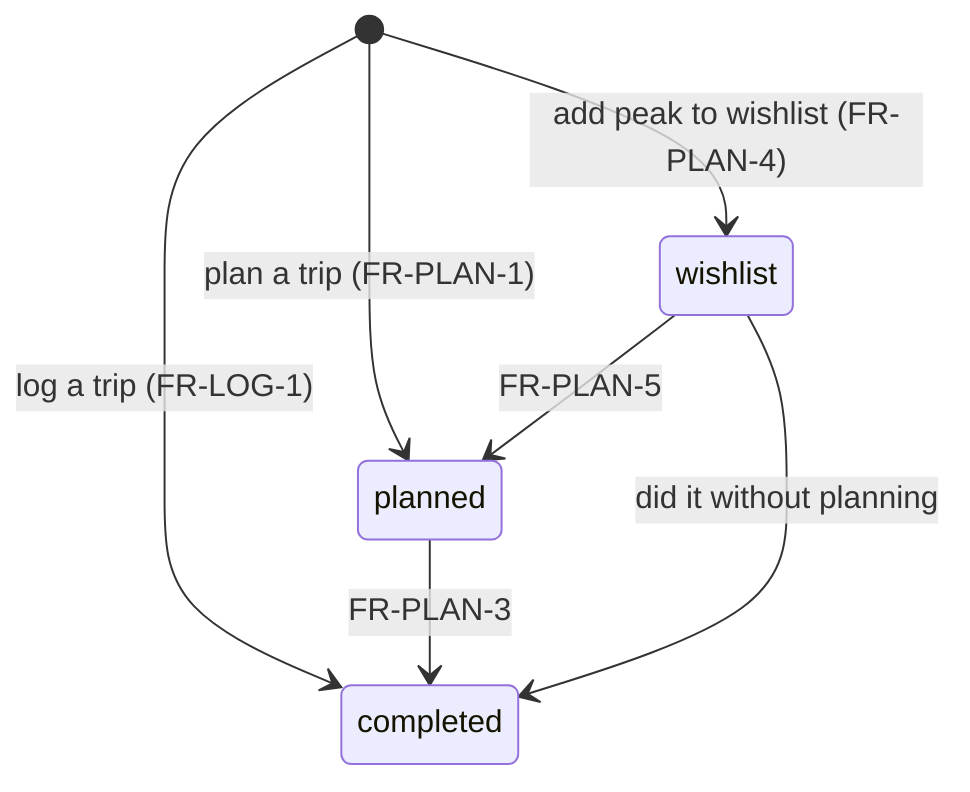

# Trips, plans and the wishlist — implementation plan (UC-2, UC-3, UC-4)

**Status:** **Proposed** (2026-11-17). Nothing here is built. The modelling choice in §2 is
the part that needs a yes before any code — it becomes ADR-0019 (slice 0 in §7). This page
plays the role [user-accounts-mvp-plan.md](user-accounts-mvp-plan.md) played for accounts.

## 1. What we are building

Three use cases, planned as one piece of work:

| Use case | In one line | Requirements this plan closes | Left open |
| --- | --- | --- | --- |
| [UC-2](../use-cases/use-cases.md#uc-2--log-a-completed-summit-trip-turføring) Log a completed trip | Pick a peak, enter the outcome, save; the peak is bagged | FR-LOG-1..4, FR-LOG-6..8, FR-MAP-3, FR-STAT-1 | FR-LOG-5 (photos, C) |
| [UC-3](../use-cases/use-cases.md#uc-3--plan-a-future-trip-turplanlegging) Plan a future trip | Pick a peak, optionally a date; later complete it | FR-PLAN-1..3 | FR-PLAN-6 (route, C) |
| [UC-4](../use-cases/use-cases.md#uc-4--build-a-wishlist--bucket-list-ønskeliste) Build a wishlist | Collect peaks; later turn one into a plan | FR-PLAN-4..5, FR-PEAK-1..2 | FR-PEAK-3 (area filter, S) |

Sixteen requirements, none of them started in the
[traceability matrix](../requirements/traceability.md). FR-MAP-2, which UC-3 also lists, is
already implemented.

The premise: **the three use cases are one entity seen at three points in its life.** A
wishlist item is a trip with a peak and nothing else; a plan adds intent and maybe a date; a
completed trip adds what happened. The data model already says this for two of the three —
`TRIP.status` is `planned | completed` — and then keeps the wishlist as a separate
`WISHLIST_ITEM` entity with its own module and its own `/wishlist` resource. This plan
removes that exception.

## 2. The decision: one trip, one status

`Trip.status` takes three values — `wishlist`, `planned`, `completed` — and
`WISHLIST_ITEM` goes away.

| | With a separate wishlist entity (today's model) | One trip with a status (proposed) |
| --- | --- | --- |
| Tables | `Trip`, `TripPeak`, `WishlistItem` | `Trip`, `TripPeak` |
| Backend modules | Trip & Plan, Wishlist | Trips |
| API resources | `/trips`, `/plans`, `/wishlist` | `/trips?status=…` |
| FR-PLAN-5 (wishlist → plan) | Create a trip, copy the fields, delete the item — two writes that must agree | Change one column |
| "What is this peak to me?" on the map | Two queries, merged in the client | One query |
| Notes written on a wishlist item | Must be carried over by hand on conversion | Stay on the row |

**What the status does *not* settle** — the three are not identical rows with a different
label, and the plan has to carry these differences explicitly:

- **Different fields are meaningful at each stage.** A completed trip needs a date; a
  wishlist entry must not have one (a wishlist entry with a date *is* a plan). Ascent,
  difficulty and conditions describe an outcome and are only asked for on completion. This
  is validation per status, enforced in the API and backed by `CHECK` constraints.
- **Only `completed` counts.** Bagged peaks (FR-LOG-8) and statistics (FR-STAT-1) read
  completed trips only. "Bagged" is **derived** — there is no stored flag, so editing or
  deleting a trip cannot leave a peak wrongly ticked.
- **A peak's state is not a trip's state.** Ingrid can have climbed Galdhøpiggen in 2024 and
  have it planned again for 2027. The trip rows each keep their own status; the *peak's*
  colour on the map is derived by precedence: completed, else planned, else wishlist.
- **The wishlist is a set, trips are a log.** Logging the same peak twice is two trips;
  wishing for it twice is a mistake. "Add to wishlist" is therefore idempotent per peak.

## 3. Data model (`rekfar/database`, `app` schema)

Per [ADR-0013](../adr/0013-schema-owned-by-sql-database-project.md) the tables are declared
in the SQL Database Project, beside `app.User`.

**`app.Trip`**

| Column | Type | Rule |
| --- | --- | --- |
| `Id` | guid | `app`-schema convention |
| `UserId` | guid | FK `app.User`; every query filters on it |
| `Status` | `wishlist` / `planned` / `completed` | `CHECK`; not null |
| `Type` | `fottur` / `topptur` | not null; defaults to `topptur` when created from a peak |
| `TripDate` | date, nullable | `completed` ⇒ required; `wishlist` ⇒ null; `planned` ⇒ optional target date |
| `AscentMeters` | int, nullable | ≥ 0 |
| `Difficulty` | `enkel` / `middels` / `krevende` / `ekspert`, nullable | |
| `Conditions` | short text, nullable | føre |
| `Notes` | text, nullable | private; see open question 1 |
| `Privacy` | as `app.User.DefaultPrivacy` | copied from the user's default at creation; not exposed until sharing exists |
| `CreatedAt`, `UpdatedAt` | datetime2 | schema convention |

**`app.TripPeak`** — `TripId`, `PeakId` (bigint FK to `[ref].Peak`), `Ordinal`; primary key
`(TripId, PeakId)`. A join table rather than a column because FR-LOG-2 says "one or more"
and a traverse bags several. `[ref].Peak` already keeps retired rows (`IsActive = 0`), so the
foreign key survives an upstream deletion.

Indexes: `Trip (UserId, Status, TripDate)` for the lists, `TripPeak (PeakId)` for "my
history on this peak".

No `Track`, `Route` or `Photo` tables — those arrive with FR-DATA-1, FR-PLAN-6 and FR-LOG-5.

## 4. API (`rekfar/backend`, new `Rekfar.Trips` module)

| Endpoint | Purpose | Requirements |
| --- | --- | --- |
| `GET /v1/trips?status=&peakId=` | The caller's trips, each with its peaks embedded (id, name, elevation, coordinates) | FR-MAP-3, FR-PLAN-2 |
| `POST /v1/trips` | Create in any of the three statuses | FR-LOG-1..4, FR-PLAN-1, FR-PLAN-4 |
| `GET /v1/trips/{id}` | One trip | FR-LOG-7 |
| `PATCH /v1/trips/{id}` | Edit fields **and** change status; the per-status rules from §2 are checked on the resulting row | FR-LOG-6, FR-PLAN-3, FR-PLAN-5 |
| `DELETE /v1/trips/{id}` | Delete (this is also "remove from wishlist") | FR-LOG-6 |
| `GET /v1/stats` | Peaks bagged, total ascent, number of trips — completed only | FR-STAT-1 |
| `GET /v1/peaks/search?q=` | Name search over the existing `SearchName` column | FR-PEAK-1 |
| `GET /v1/peaks/{id}` | Peak detail (reference data only, cacheable) | FR-PEAK-2 |

Design points:

- **No `/v1/plans` or `/v1/wishlist`.** They are filters on `/v1/trips`. The indicative
  resource list in [application architecture §3](04-application-architecture.md#3-api-boundary)
  and the backend README lose those two entries.
- **Conversion is a `PATCH` of `status`**, not a special endpoint. Completing a plan sends
  `status: completed` together with the date and outcome fields in one request.
- **User state stays out of `GET /v1/peaks`.** That endpoint is anonymous and publicly
  cached; mixing "have I bagged this" into it would end the caching. A user has hundreds of
  trips at most, so the client fetches `/v1/trips` once and joins on peak id. "Bagged or not"
  on the peak detail (FR-PEAK-2) comes from the same list.
- **Trips carry their peaks' coordinates.** `GET /v1/peaks` returns only the 500 highest
  peaks in view, so a modest wishlist peak may not be in it. The user's own peaks must be
  drawable without depending on the catalogue layer.
- **Ownership is checked on every route**; another user's trip id answers 404, not 403.
- **Tests go where the rules are:** the status transitions and per-status validation, the
  bagged derivation after edit and delete, and the stats totals.

## 5. Web client (`rekfar/webapp`)

- **Peak popup** gains the peak's state for the signed-in user and three actions:
  *Loggfør tur*, *Planlegg tur*, *Legg i ønskeliste*.
- **One trip form**, whose fields follow the status: wishlist shows peak and notes; planned
  adds type and an optional date; completed adds required date, ascent, difficulty and
  conditions. *Fullfør* on a plan and *Planlegg* on a wishlist entry open the same form with
  the next status preselected.
- **`/turer`** — the user's trips in three tabs (Gjennomført / Planlagt / Ønskeliste), with
  edit, delete and the convert actions. **`/turer/:id`** — trip detail with a small map of
  its peaks (FR-LOG-7; photos join it with FR-LOG-5).
- **Peak search** in the form and in the header (FR-PEAK-1); **`/topper/:id`** — peak detail
  with the user's history on it (FR-PEAK-2).
- **Map:** a "my peaks" layer above the catalogue markers in three styles — filled
  (completed), outlined (planned), dimmed (wishlist) — the "three visual states" idea from
  the [idea backlog](../use-cases/use-cases.md#sharpening-the-core-identity). Clicking one
  opens the trip (FR-MAP-3, FR-PLAN-2).
- **Totals** (FR-STAT-1) as a strip on `/turer`; a full statistics page waits for UC-8.
- All strings through the existing `nb-NO` layer; everything behind `RequireSession`.

## 6. Out of scope

Photos (FR-LOG-5), routes on a plan (FR-PLAN-6), area and elevation filters (FR-PEAK-3 —
there is no `AREA` data yet), GPX and tracks (UC-7), the guestbook (FR-BOOK-3..6), exposing
default privacy on the profile (FR-ACC-4), and trips without a peak appearing on the map —
they have no location until tracks exist, so they show in the list only.

## 7. Delivery outline

Six slices, in order, each shippable. The backend is built once because it is one resource;
the web client is split so the Must (UC-2) ships before the Shoulds.

| # | Repository | Slice | Closes |
| --- | --- | --- | --- |
| 0 | `docs` | **ADR-0019** — a trip has one lifecycle (`wishlist → planned → completed`). Update the data architecture (drop `WISHLIST_ITEM`, three-value status), the application architecture (fold the Wishlist module into Trips, drop `/plans` and `/wishlist`), and the roadmap (the wishlist moves from Phase 2 into Phase 1). No requirement IDs change. | — |
| 1 | `database` | `app.Trip`, `app.TripPeak`, constraints, indexes; smoke test | — |
| 2 | `backend` | `Rekfar.Trips` module: CRUD, lifecycle rules, `/v1/stats` | — |
| 3 | `backend` | `GET /v1/peaks/search`, `GET /v1/peaks/{id}` | — |
| 4 | `webapp` | **UC-2:** peak search, log a completed trip from the popup, `/turer` list with edit and delete, bagged style on the map, trip detail, totals | FR-LOG-1..4, 6..8, FR-MAP-3, FR-STAT-1, FR-PEAK-1 |
| 5 | `webapp` | **UC-3 + UC-4:** the two remaining statuses in the form, tabs, convert actions, planned and wishlist map styles, peak detail page | FR-PLAN-1..5, FR-PEAK-2 |

Slices 1–3 close no requirement on their own: a requirement is closed by the pull request
that makes it usable, per the [traceability convention](../requirements/README.md). Slices 2
and 3 are independent of each other and can land in either order. Slice 5 is deliberately
small — by then the table, the endpoints and the form exist, and the work is two more values
of one field. That is the pay-off of §2.

## 8. Open questions

1. **Is `Trip.Notes` the diary note?** The data model has both `TRIP.notes` (FR-LOG-4) and
   a separate `DIARY_NOTE` entity (FR-BOOK-1), and UC-2's flow says "add a private diary
   note". Recommendation: one private `Notes` field on the trip now, closing FR-LOG-4, and
   decide in ADR-0019 whether it also satisfies FR-BOOK-1..2 or whether dated, multiple
   diary notes are still wanted.
2. **Can a completed trip go back to planned?** Recommendation: yes, through ordinary
   editing — it is a correction, the rules in §2 are re-checked, and forbidding it buys
   nothing.
3. **Does a wishlist entry need exactly one peak?** Recommendation: yes in the UI (it keeps
   "add to wishlist" idempotent); the schema allows more, which leaves room for FR-PLAN-4's
   "trip idea".
4. **Is the real catalogue in place?** FR-REF-1 is still "Not started" in the matrix. Trips
   only need `[ref].Peak` rows to point at, so development works against the seed peaks, but
   a logbook over five development peaks is not shippable to a user.

## 9. Caveat on this plan

It was written from this repository and from the current `backend` and `webapp` code. The
`database` repository was not read, so §3 follows what the backend's mappings imply about
its conventions (guid keys in `app`, bigint in `ref`); check it against
`database/docs/conventions.md` before slice 1.
